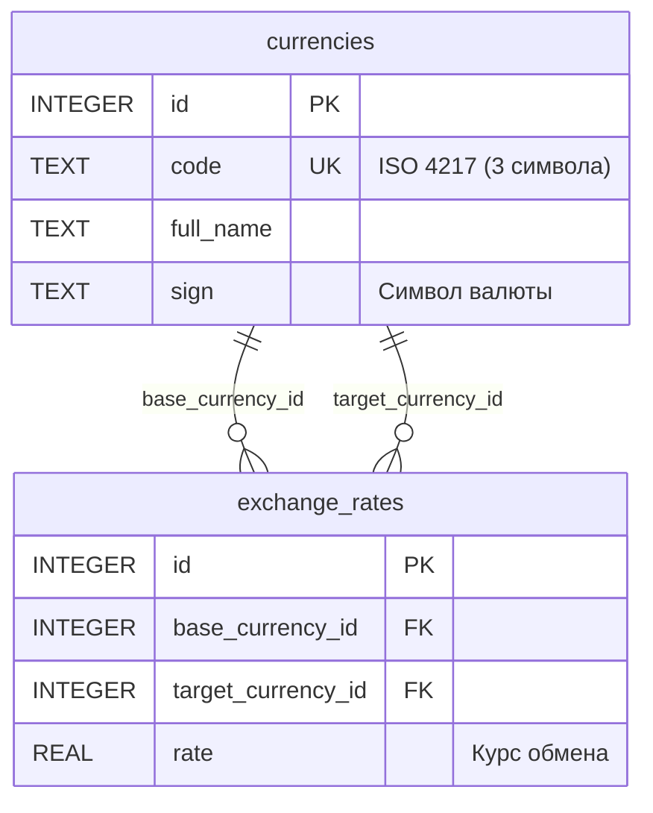

# Currency Exchange REST API

REST API веб-сервис для управления валютами, обменными курсами и выполнения валютных конвертаций.

Проект реализован в рамках закрепления базовых концепций Java Backend: работа с **чистыми Jakarta Servlets** (без использования Spring Framework), ручное внедрение зависимостей (Pure DI), организация пула соединений с БД и чистая многослойная архитектура.

---

## 🚀 Особенности и возможности

- **Управление валютами:**
  - Получение полного списка доступных валют.
  - Поиск валюты по 3-буквенному коду ISO 4217 (например, `USD`, `EUR`).
  - Добавление новой валюты с валидацией входных параметров.
- **Управление обменными курсами:**
  - Получение списка всех зафиксированных обменных курсов.
  - Получение курса для конкретной валютной пары (например, `USDEUR`).
  - Добавление нового курса валют.
  - Изменение существующего курса через HTTP-метод `PATCH`.
- **Конвертация валют:**
  - Расчет перевода заданной суммы из базовой валюты в целевую.
  - Автоматическое определение одного из трех сценариев конвертации:
    1. **Прямой курс:** прямая пара $A \to B$ существует в базе.
    2. **Обратный курс:** существует обратная пара $B \to A$ (курс рассчитывается как $1 / rate$).
    3. **Кросс-курс через USD:** рассчитывается через промежуточные курсы $USD \to A$ и $USD \to B$ (курс как $rate(USD \to B) / rate(USD \to A)$).
- **Надежность и валидация:**
  - Строгая валидация входящих параметров (формат кодов, положительные/неотрицательные суммы, проверка на дубликаты).
  - Централизованная обработка исключений с единым форматом JSON-ответа для ошибок: `{"message": "..."}`.
  - Гарантированная установка кодировки `UTF-8` и `Content-Type: application/json` для ответов (включая страницы ошибок).
  - Проверка обязательного `Content-Type: application/x-www-form-urlencoded` для мутирующих запросов (`POST`, `PATCH`).
  - Парсинг тела формы для методов `PATCH`/`PUT` через `HttpServletRequestWrapper` в обход ограничений сервлет-контейнера.

---

## 🛠 Стек технологий

| Технология | Назначение | Версия |
|---|---|---|
| **Java** | Язык программирования | 25 |
| **Jakarta Servlet API** | Спецификация сервлетов и веб-фильтров | 6.1.0 |
| **Jetty EE11 Plugin** | Встраиваемый сервлет-контейнер для запуска | 12.1.14 |
| **SQLite JDBC** | Реляционная СУБД | 3.53.4.0 |
| **HikariCP** | Высокопроизводительный пул соединений с БД | 7.1.0 |
| **Jackson Databind** | Сериализация и десериализация JSON (`tools.jackson`) | 3.2.4 |
| **MapStruct** | Декларативный маппинг Entity $\leftrightarrow$ DTO | 1.6.3 |
| **Lombok** | Генерация boilerplate-кода для моделей | 1.18.48 |
| **Apache Maven** | Сборка и управление зависимостями (`war`) | 3.9+ |

---

## 🏛 Архитектура и дизайн

Приложение построено по принципам классической трёхуровневой архитектуры:

```
[ HTTP Request ]
       │
       ▼
[ Filters (Validation, Form Parser, JSON/Encoding) ]
       │
       ▼
[ Servlets (Controller Layer) ] ──▶ [ Validators & Request DTOs ]
       │
       ▼
[ Services (Business Layer) ]   ──▶ [ Currency / Exchange Logic ]
       │
       ▼
[ DAOs (Data Access Layer) ]    ──▶ [ HikariCP / SQLite JDBC ]
       │
       ▼
[ SQLite Database ]
```

### Ключевые проектные решения:
* **Inversion of Control без фреймворков:** создание синглтонов (DAO, Services, Validators, ObjectMapper) и инициализация пула `HikariCP` выполняются один раз при старте приложения в `AppContextListener` (`ServletContextListener`). Сервлеты получают зависимости через контекст сервлета в методе `init()`.
* **Изоляция слоёв через DTO:** HTTP-слой принимает параметры и упаковывает их в Record DTO, где происходит первичная нормализация (`strip()`). Сервисный слой оперирует типизированными данными и не зависит от HTTP-специфики.
* **Централизованный Error Handling:** обработка всех ошибок и исключений бизнес-логики вынесена в специализированный `ErrorServlet`, зарегистрированный через `<error-page>` в `web.xml`.

---

## 🗄 Схема базы данных

База данных SQLite состоит из двух связанных таблиц:



---

## 📡 REST API Спецификация

Базовый путь API при локальном запуске: `http://localhost:8080/api`

### 1. Валюты (`/currencies`, `/currency`)

| Метод | Путь | Параметры | Описание | Коды ответов |
|---|---|---|---|---|
| `GET` | `/currencies` | — | Получить список всех валют | `200` |
| `GET` | `/currency/{code}` | Path: `code` | Получить валюту по ISO коду | `200`, `400`, `404` |
| `POST` | `/currencies` | Form Data: `code`, `name`, `sign` | Добавить новую валюту | `201`, `400`, `409` |

<details>
<summary>Примеры запросов и ответов</summary>

**GET `/api/currencies`**
```json
[
  {
    "id": 1,
    "code": "USD",
    "name": "US Dollar",
    "sign": "$"
  },
  {
    "id": 2,
    "code": "EUR",
    "name": "Euro",
    "sign": "€"
  }
]
```

**POST `/api/currencies`**
```bash
curl -X POST http://localhost:8080/api/currencies \
  -d "code=GBP&name=British Pound&sign=£"
```
</details>

---

### 2. Обменные курсы (`/exchangeRates`, `/exchangeRate`)

| Метод | Путь | Параметры | Описание | Коды ответов |
|---|---|---|---|---|
| `GET` | `/exchangeRates` | — | Список всех обменных курсов | `200` |
| `GET` | `/exchangeRate/{pair}` | Path: `pair` (например `USDEUR`) | Получить курс валютной пары | `200`, `400`, `404` |
| `POST` | `/exchangeRates` | Form Data: `baseCurrencyCode`, `targetCurrencyCode`, `rate` | Добавить новый курс | `201`, `400`, `404`, `409` |
| `PATCH` | `/exchangeRate/{pair}` | Path: `pair`, Form Data: `rate` | Обновить курс существующей пары | `200`, `400`, `404` |

<details>
<summary>Примеры запросов и ответов</summary>

**GET `/api/exchangeRate/USDEUR`**
```json
{
  "id": 1,
  "baseCurrency": {
    "id": 1,
    "code": "USD",
    "name": "US Dollar",
    "sign": "$"
  },
  "targetCurrency": {
    "id": 2,
    "code": "EUR",
    "name": "Euro",
    "sign": "€"
  },
  "rate": 0.920000
}
```

**PATCH `/api/exchangeRate/USDEUR`**
```bash
curl -X PATCH http://localhost:8080/api/exchangeRate/USDEUR \
  -d "rate=0.95"
```
</details>

---

### 3. Обмен валют (`/exchange`)

| Метод | Путь | Query-параметры | Описание | Коды ответов |
|---|---|---|---|---|
| `GET` | `/exchange` | `from` (код), `to` (код), `amount` (сумма) | Рассчитать обмен суммы валют | `200`, `400`, `404` |

<details>
<summary>Пример запроса и ответа</summary>

**GET `/api/exchange?from=USD&to=EUR&amount=100.00`**
```json
{
  "baseCurrency": {
    "id": 1,
    "code": "USD",
    "name": "US Dollar",
    "sign": "$"
  },
  "targetCurrency": {
    "id": 2,
    "code": "EUR",
    "name": "Euro",
    "sign": "€"
  },
  "rate": 0.920000,
  "amount": 100.00,
  "convertedAmount": 92.00
}
```
</details>

---

### Формат ошибок API

В случае ошибок валидации, отсутствия сущностей или некорректных параметров возвращается JSON:

```json
{
  "message": "currency USD does not exist"
}
```

---

## ⚙️ Сборка и запуск

### Требования
* **JDK 25** (или настроенная совместимая среда)
* **Apache Maven 3.9+**

### 1. Клонирование репозитория
```bash
git clone https://github.com/xoaltie/currency-exchange.git
cd currency-exchange
```

### 2. Запуск через встроенный Jetty плагин
В проект уже встроен и сконфигурирован плагин `jetty-ee11-maven-plugin`. Установка внешнего Tomcat не требуется:

```bash
mvn clean jetty:run
```

После старта сервер доступен по адресу:
```
http://localhost:8080/api/currencies
```

### 3. Сборка WAR-пакета (опционально для развертывания в Tomcat)
```bash
mvn clean package
```
Собранный архив `currency-exchange-1.0-SNAPSHOT.war` будет расположен в директории `target/`.
